# cert-dashboard

An internal dashboard for the TLS certificates an organisation owns that a public CA cannot renew
over ACME. It imports them, shows what expires next, watches what the registered endpoints actually
serve, mails the people who need to know, walks a manual-CA renewal from key and CSR to an issued
certificate, and deploys the result to nginx and Apache hosts with automatic rollback.

It runs as one Compose stack on a single internal Linux host and talks to no external service.
Private keys and TOTP seeds are stored encrypted under a keyring the operators hold.

It is not a CA and signs nothing. There is no ACME/Let's Encrypt flow and no CA API integration, it
never edits nginx or Apache configuration, it does not check OCSP or CRL, and it has no
high-availability or multi-tenant mode. Every active user is an administrator: v1 has no RBAC.

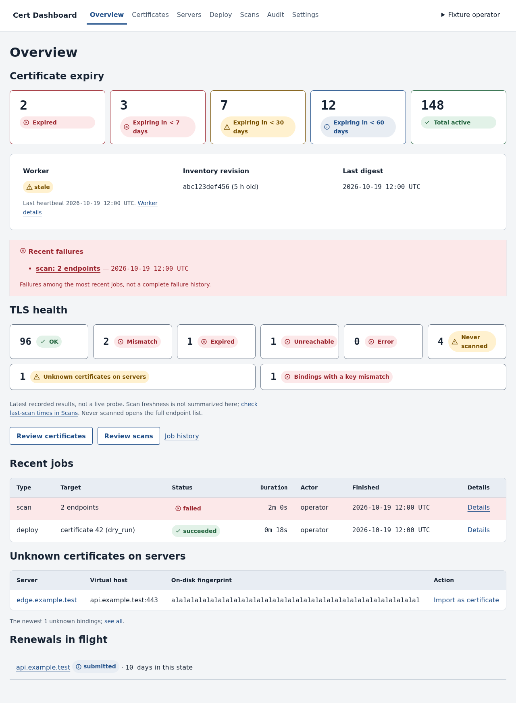

**What you get**

- Certificate inventory: import by upload or from `host:port`, per-chain trust assessment, encrypted
  private keys, audited PEM, chain and PFX downloads.
- Expiry awareness: thresholds, e-mail alerts and a daily digest over your own SMTP relay.
- TLS observation: scheduled scans that record what an endpoint serves next to what is stored.
- Manual-CA renewal: a resumable wizard from key and CSR to an issued certificate.
- Deployment: discovery from an Ansible inventory, canary-first rollout, automatic per-host rollback.
- Access and audit: local accounts with TOTP MFA, an append-only audit trail, database sessions.

## Contents

- [Certificate inventory](#certificate-inventory) · [Expiry awareness](#expiry-awareness) ·
  [TLS observation](#tls-observation) · [Renewal](#renewal)
- [Deployment](#deployment) · [Access and audit](#access-and-audit)
- [Security model](#security-model) · [Quick start](#quick-start) · [Configuration](#configuration)
- [Operations](#operations) · [Architecture](#architecture) · [Development](#development)
- [License and status](#license-and-status)

## Certificate inventory

Import by upload (PEM, CRT or PFX; 1 MiB per object, 4 MiB per request) or pull the chain a host
actually serves from `host:port` with an optional SNI name. Chain and key are optional on upload, and
a supplied key is encrypted before it is stored.

- A certificate already stored is matched by SHA-256 fingerprint and a key by SPKI hash, so an import
  attaches the key to the existing row instead of duplicating the certificate
  (`certificate.import_duplicate`).
- Every stored chain is assessed against the internal CA roots you upload plus the pinned public
  bundle: `trusted`, `incomplete`, `untrusted_root` or `unchecked`. Roots are never stored as part of a
  chain, and an untrusted chain is a warning, not a blocked import.
- Downloads are leaf PEM, chain PEM, full chain PEM and a password-protected PFX rebuilt in memory
  after you re-enter your own password, each audited (`certificate.download`, `key.export`,
  `key.export_failed`). There is no PEM private-key export.
- The list filters, sorts, keeps bookmarkable queries, shows 50 rows per page (up to 100) and exports
  JSON; the detail page adds chain status, key presence and public fingerprint, lineage, audit rows,
  the endpoints panel and the deploy panel.

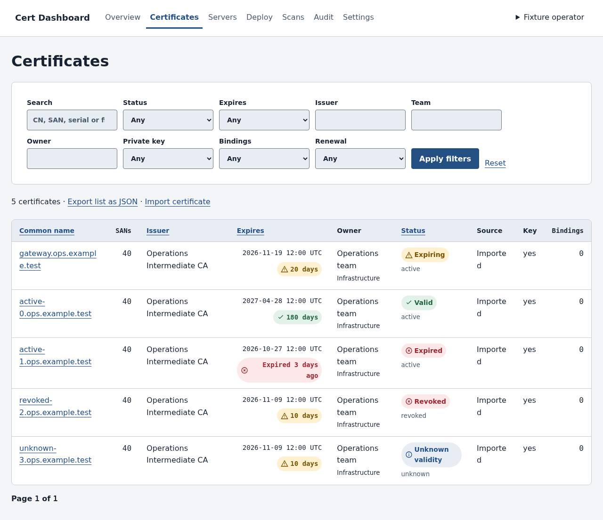

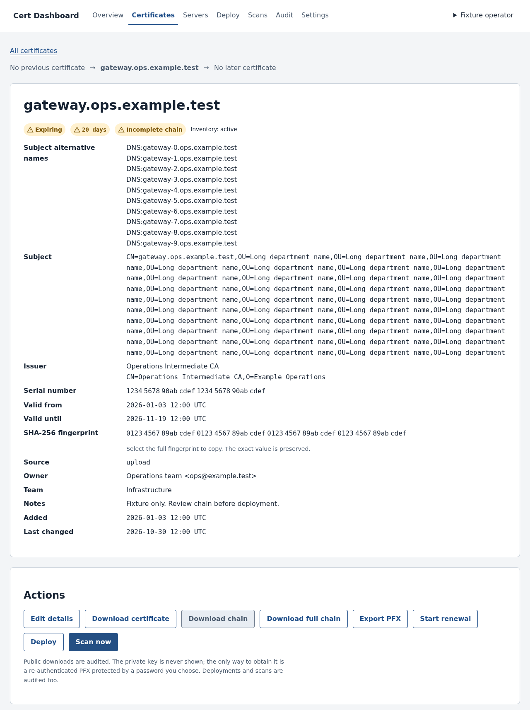

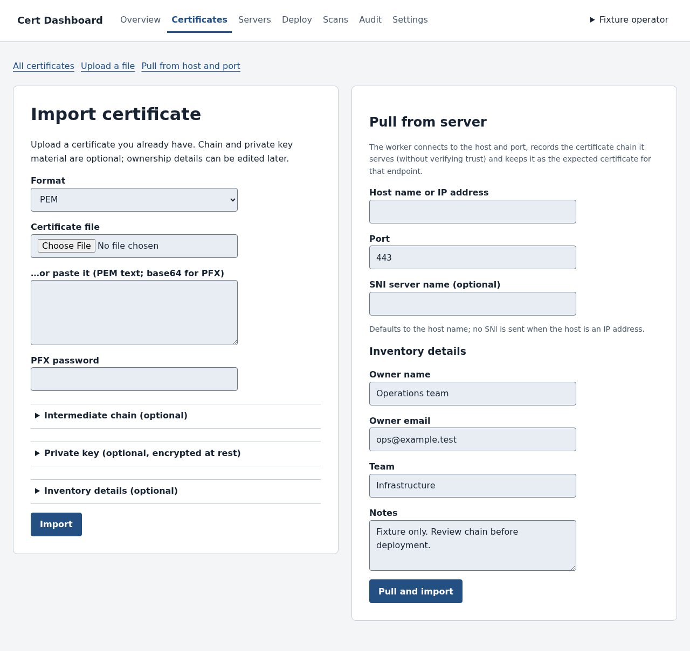

## Expiry awareness

Each active certificate is evaluated against `alert.thresholds_days` (`60, 30, 14, 7, 1, 0` by
default), and the smallest threshold it has crossed produces one e-mail per certificate and threshold.

- Recipients: the certificate's owner first, then `alert.recipients`, deduplicated. The daily digest
  goes to `alert.recipients` only, with no owner fallback, so an empty list leaves every digest as a
  failed `no_recipients` row.
- A `notification_log` ledger with a unique dedupe key and a row lock stops a threshold from being
  mailed twice. Delivery is at-least-once: a crash between the relay accepting the mail and the ledger
  commit can resend one message. Only transient failures retry (connect, timeout, 4xx reply), up to
  three attempts; AUTH, TLS and permanent rejections wait for the next scheduled run and appear in
  Settings → Alerts.
- The digest at `07:30` UTC lists expiring and expired certificates, new TLS mismatches, unknown
  certificates, stale servers, failed jobs, rolled-back hosts and failed notifications, and is sent
  even when every section is empty.
- Mail leaves the worker only, over STARTTLS, SSL/TLS or plaintext as configured, and AUTH is
  attempted only over TLS. `smtp_password` is a worker-only file secret.

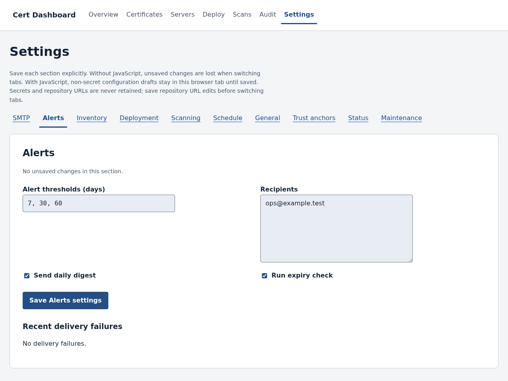

## TLS observation

An endpoint is `host:port` plus an optional SNI name and an optional expected certificate. Discovery
adds endpoints from bindings; you can also add them by hand.

- The worker scans every endpoint daily at `02:00` UTC (`scan.daily_at`) or on demand, with 20
  connections in flight and 10 s per endpoint. Each attempt stores one classified result — `ok`,
  `mismatch`, `expired`, `unreachable` or `error` — with the served fingerprint, common name, issuer,
  expiry, TLS version, chain length and elapsed time; the last 20 results per endpoint stay browsable,
  and an unreachable endpoint is retried alone, up to three times, without re-scanning healthy ones.
- The expected certificate is snapshotted into each result, so the detail page shows what is stored
  next to what is served.
- Observed certificates are never imported, matched into inventory or trusted. `chain_status` changes
  only through an explicit trust recheck, which runs daily and after every trust-anchor change.

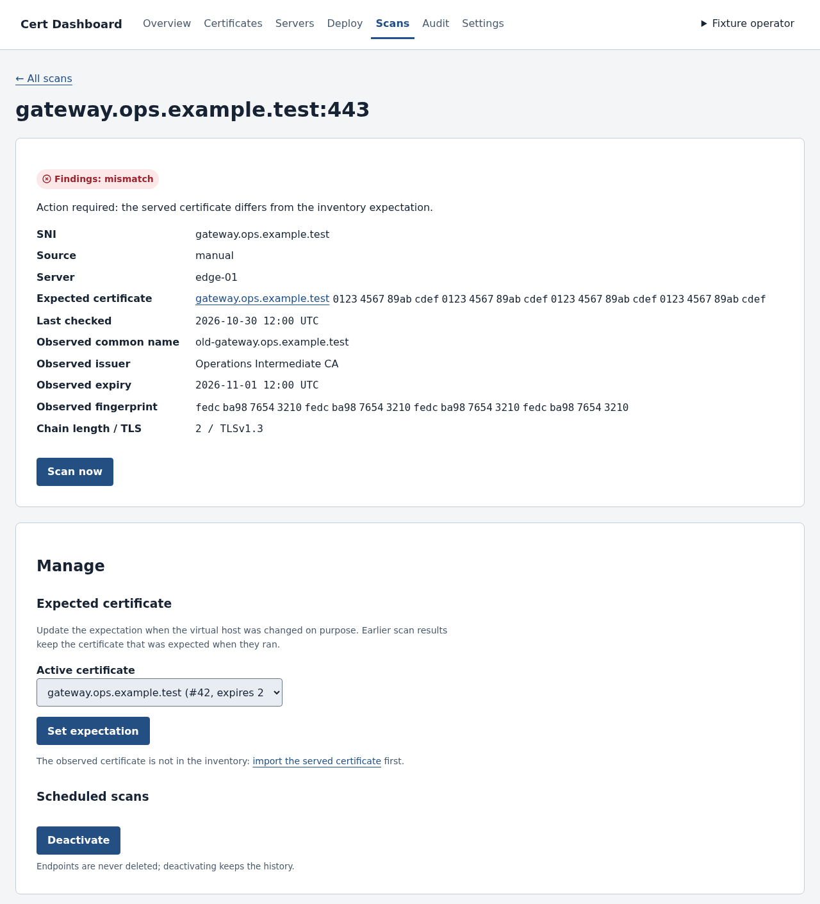

## Renewal

The renewal wizard has six steps — Basics, CSR, Order, Upload, Ready, Done — and resumes where it
stopped.

- The key is generated on the server (RSA 2048/3072/4096 or ECDSA P-256/P-384, RSA 2048 by default)
  and stored encrypted; the CSR is downloaded from the page.
- The CA step is explicit: the CSR page shows the request's SHA-256 to compare with the CA portal, the
  ordering checklist, and a field for the CA order reference. The dashboard never contacts a CA.
- The issued certificate is uploaded with an optional chain, and the gate checks the key and CSR SPKI,
  the CN/SAN set and the validity dates before the renewal becomes `issued`, ready to deploy.
- A renewal becomes `deployed` only after a succeeded deploy job with a succeeded binding carrying the
  new fingerprint; `finalize` then changes the previous certificate's status. A paused, failed or
  cancelled deploy never advances it.

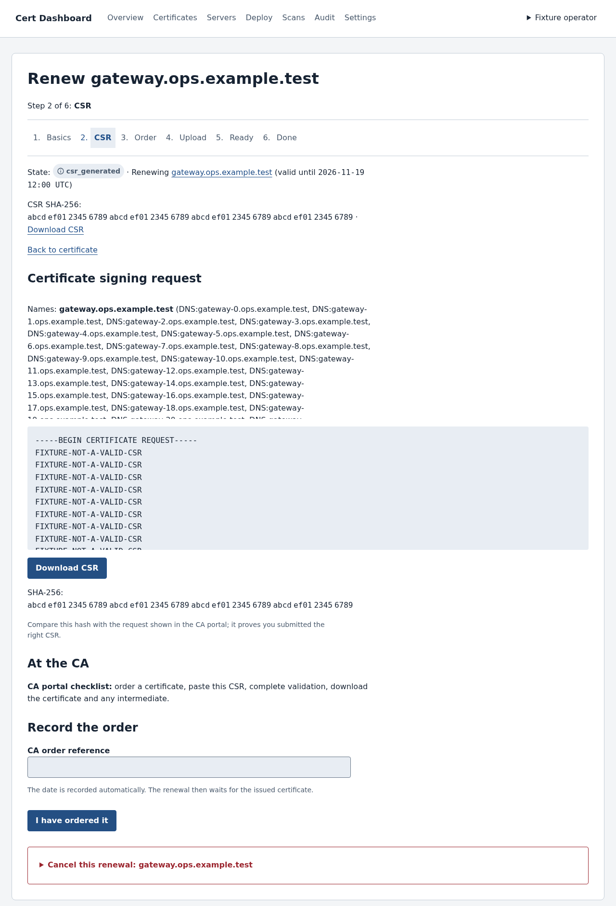

## Deployment

Settings → Inventory points the worker at a Git repository of Ansible inventory (URL, ref, checkout
path, `webserver_var`). The worker keeps a read-only checkout and runs Ansible read-only against the
listed nginx and Apache hosts: it reads configuration, certificates and keys, never writes a file and
never reloads a service.

- Certificate roles are decided by verifying file content: a chain file counts only when it really
  signs the leaf, and an unreadable or incomplete chain is diagnosed instead of guessed. Apache
  includes are read recursively as well as through `apachectl -S`; nginx includes come from `nginx -T`.
- Reconciliation upserts servers and bindings without duplicates, never imports an unknown certificate
  and never deletes a binding. A host that previously had bindings and suddenly yields none is marked
  `parse_suspected` instead of being emptied.
- The deploy preview shows every host's current and new identity, the files that change and the batch
  plan. Starting requires echoing the preview's `plan_sha256` and ticking the confirmation, so a plan
  that changed in between is refused rather than started. Guardrails refuse a start without a key, with
  an expired or revoked certificate, with no target, when every binding is already on the new
  fingerprint, when another deploy is queued, running or paused, or when the chain is not trusted
  without an audited override.
- Rollout is canary first, then batches of `max(1, ceil(total × deploy.batch_percent / 100))`. With
  *pause after canary* the job waits for **Continue**, which re-checks drift on every host; a forgotten
  pause auto-cancels after `deploy.pause_timeout_hours`.
- Each host is backed up to `/var/backups/cert-dashboard/<job_id>/` with a `manifest.json`, written
  atomically, config-tested, reloaded and verified on the served port. Any failure from the first write
  onwards triggers exactly one automatic rollback of every backed-up path; the first failed host stops
  the rollout and hosts that never started are `skipped`. Backups are pruned after
  `deploy.backup_retention_days` (30; `0` keeps them forever), always keeping the newest copy of a path.
- Deploy jobs are never retried automatically; **Retry host** creates a new audited job.

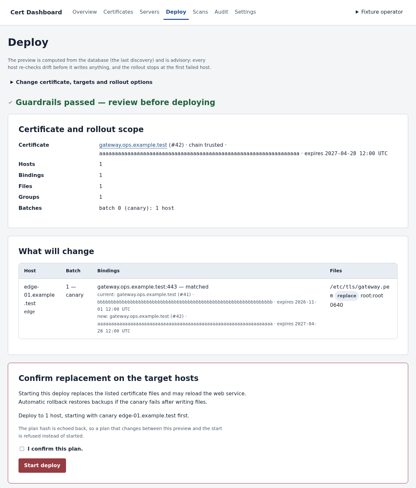

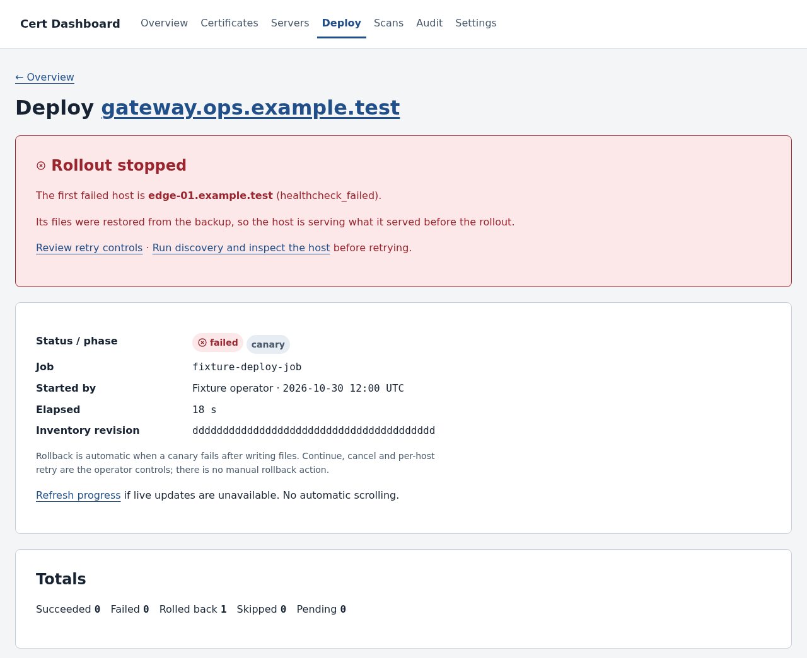

## Access and audit

- Local accounts only. The LDAP backend exists as a reserved stub that returns `not_supported`; no
  directory integration is implemented in v1, and every active user is an administrator.
- TOTP two-factor authentication with single-use recovery codes. Ten consecutive failures lock an
  account for 15 minutes, a password change revokes the other sessions, and the last active user
  cannot be deactivated.
- Sessions are opaque rows in PostgreSQL: 24 h absolute, 8 h idle, a per-session CSRF token on every
  non-GET request, and a 10-minute pre-authentication session with no admin authority.
- The audit log is append-only for the application role, which cannot update or delete it, and audit
  rows share the transaction of the change they describe. The browser filters by actor, action prefix,
  target, time and IP, and exports the newest 5,000 rows as JSON metadata.

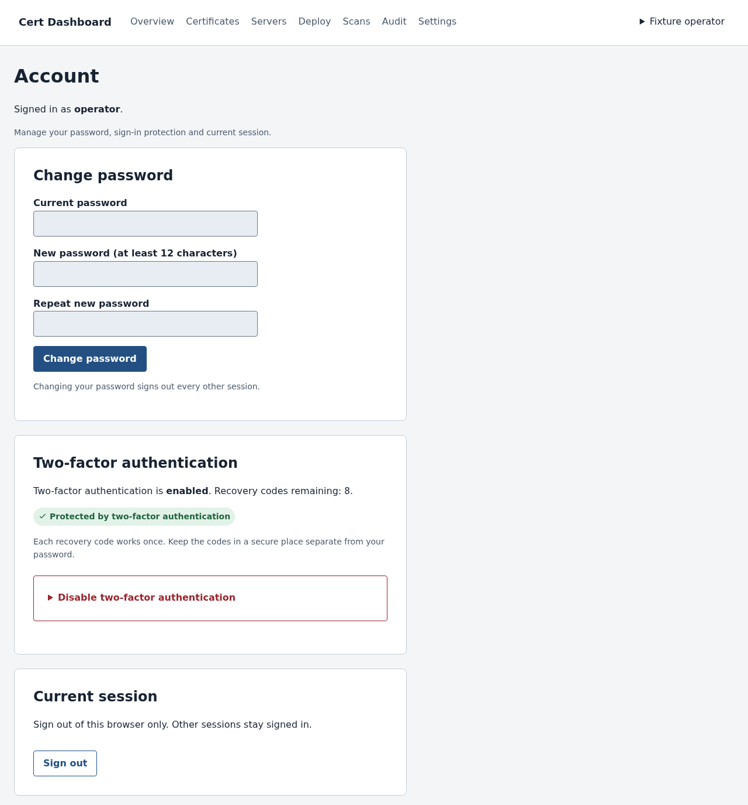

*The data in these images is synthetic: they are renders of the repository's own preview fixtures
(`docs/ui/previews/`), not captures of a real inventory.*

## Security model

- **Encrypted at rest.** Private keys and TOTP seeds are AES-256-GCM ciphertext with a row-bound AAD,
  under a versioned keyring that holds at most two live versions.
- **Key custody is yours.** `master_key` is a file secret (`0400`, `10001:10001`) the database never
  contains. Keep three copies in two locations, rotate at least annually or when a custodian leaves or
  a copy may have leaked, and restore a dump into a staging stack every quarter. A version that no copy
  holds makes every key wrapped under it unrecoverable: those certificates must be re-keyed and
  re-issued, because there is no recovery path without the keyring.
- **File secrets only.** `master_key`, `session_secret`, `db_password`, `db_owner_password` and the
  optional worker credentials are read-only file mounts, read once at startup, and never appear in the
  database, a compose value, argv, a log or the UI.
- **Nothing leaves the host.** No telemetry, licence check or external API call. The only outbound
  traffic is to your SMTP relay, from the worker, and SSH/Ansible to the hosts you configure.
- **Refusals.** No PEM private-key export. No deploy without a key, valid dates and a trusted chain, or
  an audited override that still cannot bypass key, validity, drift or config-test checks. Trust
  anchors must be self-signed CA roots, observed certificates are never trusted, audit rows are never
  deleted, and nginx or Apache configuration is never edited.
- **Hardened runtime.** UID 10001, read-only root filesystem, all capabilities dropped,
  `no-new-privileges`, `noexec` `/tmp`, a private tmpfs for decrypted key material, 4 MiB request
  bodies, PFX parsing in a resource-limited child process, and structured logs that carry route, status
  and request ID but never query strings, cookies, bodies or exception text.

## Quick start

Requires Docker Engine with the Compose plugin, a Linux host, and root for the one-time secret
provisioning. `web` is published on `127.0.0.1:8000`; put your TLS proxy in front of it. Prerequisites
and the secret ownership table are in [`docs/operations.md`](docs/operations.md) §1–§2.

```sh
git clone https://github.com/andreafunicelli/cert-dashboard.git
cd cert-dashboard
set -eu

# 1. Build the runtime image every command below uses.
docker build -t cert-dashboard:local .

# 2. Generate the first master key and install it 0400 10001:10001 (as root): the recipe from
#    docs/operations.md §2.1. The block stops on the first failure, so a failed digest check ends it
#    before install and shred run.
install -d -m 0711 -o 0 -g 0 /etc/cert-dashboard/secrets
tmp="$(mktemp -d /tmp/cert-dashboard-keyring.XXXXXXXX)"; install -d -m 0700 -o 10001 -g 10001 "$tmp"
metadata="$(docker run --rm -v "$tmp":/out cert-dashboard:local python -m app.cli generate-master-key --version 1 --output /out/master_key.new)"
printf '%s\n' "$metadata"
expected="${metadata%% *}"; expected="${expected#sha256=}"
printf '%s  %s\n' "$expected" "$tmp/master_key.new" | sha256sum --check -
install -m 0400 -o 10001 -g 10001 "$tmp/master_key.new" /etc/cert-dashboard/secrets/master_key
shred -u -- "$tmp/master_key.new"; rmdir -- "$tmp"

# 3. Provision the other three secrets straight into their files (nothing on argv, nothing in shell
#    history), then apply the canonical owners and modes. The two database passwords must differ.
umask 077
head -c 48 /dev/urandom | base64 -w0 > /etc/cert-dashboard/secrets/session_secret
head -c 48 /dev/urandom | base64 -w0 > /etc/cert-dashboard/secrets/db_password
head -c 48 /dev/urandom | base64 -w0 > /etc/cert-dashboard/secrets/db_owner_password
sh scripts/install-secrets.sh /etc/cert-dashboard/secrets

# 4. Start the database and apply the schema with the owner-only migrate service.
docker compose up -d db
docker compose --profile migrate -f docker-compose.yml -f docker-compose.migrate.yml run --rm migrate

# 5. Create the first administrator, interactively: the password is typed at the prompt and never
#    reaches argv, logs or the audit row.
docker compose run --rm web python -m app.cli bootstrap-admin --username admin --email admin@example.internal

# 6. Start the application and sign in at http://127.0.0.1:8000/ (or through your proxy).
docker compose up -d web worker
```

Then enroll TOTP on the Account page, import the first certificate, and open **Settings → Status**: the
worker must be `ok`, the keyring SHA-256 must match the fingerprint printed in step 2, and there must
be no `missing_key_versions` warning. Worker credentials for SMTP, SSH and Git are mounted through
`docker-compose.credentials.yml` (`docs/operations.md` §2.3).

## Configuration

Environment values come from `docker-compose.yml`; everything else is a typed setting edited in the UI
and stored in `app_setting`. Times are UTC.

| Name | Where | Default | What it does |
| --- | --- | --- | --- |
| `DB_HOST`, `DB_PORT`, `DB_NAME`, `DB_USER` | compose | `db`, `5432`, `cert_dashboard`, `app_role` | Database endpoint and runtime role |
| `WORKER_CONCURRENCY`, `MAX_PARALLEL_JOBS` | compose | `4`, `2` | Job slots and jobs run at the same time |
| `TRUSTED_PROXIES` | compose | empty | Proxy CIDRs, so client IPs in the audit log are real |
| `DASHBOARD_URL` | compose, worker | empty | Absolute `http(s)` base URL for links in e-mail |
| `SSH_KNOWN_HOSTS` | worker | `/etc/ssh/ssh_known_hosts` | Pinned host keys; a missing file fails discovery and deploy closed |
| `SECRETS_DIR` | CLI | `/run/secrets` | Where the CLI reads the file secrets |
| `smtp.host`, `smtp.port`, `smtp.security`, `smtp.username`, `smtp.from`, `smtp.tls_verify` | Settings → SMTP | empty; port from security (`587`, `465`, `25`); empty; empty; empty; `on` | Relay |
| `alert.thresholds_days`, `alert.recipients`, `alert.digest_enabled` | Settings → Alerts | `60, 30, 14, 7, 1, 0`; empty; `on` | Thresholds, team recipients, digest |
| `scan.enabled`, `scan.daily_at`, `scan.timeout_seconds` | Settings → Scanning | `on`, `02:00`, `10` | Endpoint scan |
| `discovery.enabled`, `discovery.nightly_at`, `expiry_check.enabled`, `expiry_check.daily_at`, `digest.daily_at`, `cleanup.enabled`, `cleanup.daily_at` | Settings → Schedule | `on`, `03:00`, `on`, `07:00`, `07:30`, `on`, `04:00` | Daily jobs |
| `retention.days`, `ui.timezone` | Settings → General | `90`, `UTC` | Finished jobs kept; display time zone |
| `inventory.repo_url`, `inventory.ref`, `inventory.path`, `inventory.webserver_var` | Settings → Inventory | empty, empty, empty, `webserver_type` | Inventory checkout |
| `deploy.batch_percent`, `deploy.concurrency`, `deploy.pause_after_canary`, `deploy.pause_timeout_hours`, `deploy.host_timeout_seconds`, `deploy.backup_retention_days` | Settings → Deployment | `10`, `5`, `on`, `24`, `600`, `30` | Rollout and backup retention |
| `trust.include_public_bundle` | Settings → Trust anchors | `on` | Also validate against the pinned certifi bundle |

Every change is validated against that key's own rule before anything is written, then recorded once
as `settings.update` with the before and after values.

## Operations

- **Backup.** The database holds the encrypted keys, certificates, users and the audit log; it never
  holds the master key, and a dump must never be stored beside it. Take
  `docker compose exec -T db pg_dump -Fc -U db_owner -d cert_dashboard > cert_dashboard-$(date +%F).dump`
  and prove it readable with `pg_restore --list`. Scheduling is the host's job: keep 30 daily and 12
  weekly copies off-host and restore one into a staging stack every quarter (`docs/operations.md` §4).
- **Key rotation.** Generate version N+1 merged from the current file, install it, restart `web` and
  `worker`, then `docker compose run --rm web python -m app.cli rotate-master-key` re-encrypts every key
  and TOTP seed in audited batches of 100 and prints counts only; `verify-key --certificate-id` checks
  one row. Remove the old version only after both counts are zero and a PFX export succeeded
  (`docs/operations.md` §6).
- **Upgrades.** Back up, build or pull the new image, run the migrate command from the quick start, then
  `docker compose up -d web worker`. Migrations are forward-only.
- **Logs.** `docker compose logs -f web worker`. The `json-file` driver rotates at 50 MB with five files
  per container; request logs carry route, status and request ID, never query strings, cookies, bodies
  or exception text.
- **Worker alive.** The worker writes a heartbeat every 30 seconds. When the newest heartbeat is older
  than 5 minutes every page shows a red banner (*Worker is not running*), `/healthz` returns
  `"worker": "stale"`, the container turns unhealthy and Settings → Status lists `worker_stale`.
  `/health/live` and `/health/ready` cover the web process and the database.

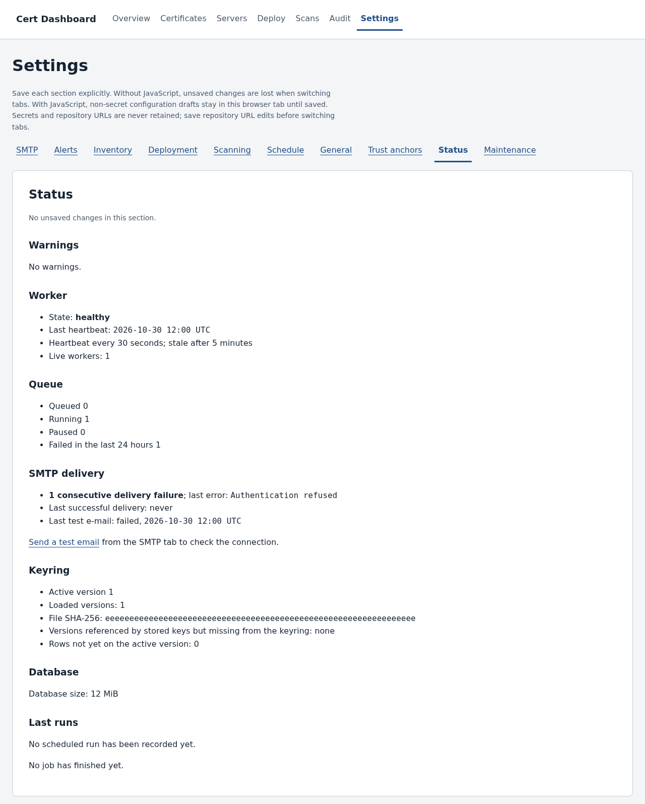

## Architecture

`web` is FastAPI/Uvicorn on `127.0.0.1:8000`: server-rendered Jinja2 with a locally served htmx,
PostgreSQL-backed sessions and CSRF on every mutating request. `worker` is `python -m app.jobs.worker`:
four job slots, the scheduler, TLS scans, the trust recheck, SMTP delivery, and the Ansible discovery
and deploy jobs. `db` is PostgreSQL 16 and holds everything except the secrets. One image
(`cert-dashboard:local`) runs both processes; `migrate` is a one-shot profile service that receives only
the database owner password. Named volumes keep `pgdata`, the inventory checkout and the discovery
artifacts, and the worker gets a private tmpfs for decrypted key material.

The worker is separate because its work is long, outbound and privileged: SSH to managed hosts, SMTP to
the relay, deploys that take minutes. Keeping it out of the request path means a slow scan or a hung
host never blocks a page, the web process never loads the SMTP password or the SSH key, and the queue
survives a restart of either process.

## Development

```sh
uv sync --frozen
uv run ruff check .
uv run pytest -q tests/unit -k 'not test_topology'   # the local gate on a Docker-less machine
```

Python 3.12 with `uv`. `tests/unit` needs no database and no network; the `test_topology` cases render
Compose files and need a reachable Docker daemon, so the local gate filters them. Integration tests need
Docker: PostgreSQL Testcontainers plus the `targets` and `ssh-targets` profiles of
`docker-compose.test.yml`, which add real nginx and Apache TLS servers and an SMTP capture container. CI
runs `uv run pytest -q --cov=app ... --cov-fail-under=70` with 85 % gates on `app/crypto`,
`app/services/renewals.py`, `app/services/deploy.py` and `app/ansible/parse_*`, plus `pip-audit` and
three compose renders; the application test image runs only `tests/unit`.

The interface has its own documents: `docs/ui/design-system.md` for tokens and rules, and
`docs/ui/previews/` for 69 rendered previews of every screen, regenerated with
`python -m scripts.render_previews`. The normative design is
`docs/superpowers/specs/2026-10-19-cert-dashboard-design.md`; the task history is the three plan files
in `docs/superpowers/plans/`. The full command set is in
[`docs/development.md`](docs/development.md#development-and-container-setup).

## License and status

No licence file is present in the repository, so no licence is granted. Add one before distributing or
reusing the code.

Status: the v1 scope of the spec is implemented. Plans 1–3 are merged (inventory and renewal, TLS
scanning and alerts, discovery and deployment) and the interface redesign merged in PRs #70–#75. The
limits stated above are the ones a reader will hit: manual CA only, nginx and Apache over SSH only,
single host, no RBAC, no OCSP or CRL, LDAP reserved but not implemented.
